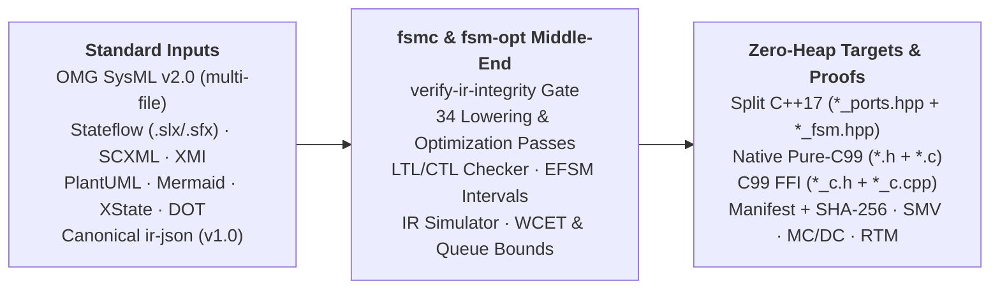

<div align="center">


# `fsmc`

[](https://github.com/simoneCavalleri/fsmc/actions/workflows/ci.yml)
[](https://simoneCavalleri.github.io/fsmc/)
[](https://github.com/simoneCavalleri.github.io/fsmc/)
[](LICENSE)
[](https://simoneCavalleri.github.io/fsmc/formal_languages/uml_reference/)
[](https://simoneCavalleri.github.io/fsmc/reference/test_suite_catalog/)

**Deterministic State Machine Compiler & Formal Verifier for Safety-Critical Systems.**  
*Compile formal MBSE statecharts into verified, zero-heap C++17/20/23 and native bare-metal Pure-C99 code—with built-in LTL/CTL model checking, WCET bounds, and SHA-256 attested system manifests.*

[Documentation](https://simoneCavalleri.github.io/fsmc/) • [Quickstart](https://simoneCavalleri.github.io/fsmc/getting_started/quickstart/) • [CLI Reference](https://simoneCavalleri.github.io/fsmc/getting_started/cli_usage/) • [CMake Integration](https://simoneCavalleri.github.io/fsmc/reference/cmake_integration/) • [Examples](examples/) • [Changelog](CHANGELOG.md)

</div>

---

## Scope & Design Principles

Embedded and safety-critical control software should neither rely on hand-written `switch` tables that drift from system specifications nor depend on opaque code generators that pull in heap allocations, virtual dispatch, or vendor lock-in.

**`fsmc`** focuses on a clear, well-bounded engineering scope—**deterministic compilation, formal verification, and zero-overhead execution of Hierarchical & Extended Finite State Machines (HFSM/EFSM)**:

- **Standard-Conformant MBSE Ingestion**: Native support for **OMG SysML v2.0** (including multi-file `import <Pkg>::*;`, `port def` & conjugated `~PortDef`, `item def`, `calc def`, `part def` with `exhibit state`, `--state-def`, `--list-machines`), **MathWorks Stateflow** (`.slx`/`.sfx`), **W3C SCXML 1.0**, **Cameo/MagicDraw XMI**, **nuXmv SMV**, visual statecharts with typed sidecars (**PlantUML, Mermaid, XState JSON, Graphviz DOT**), and canonical **`ir-json`** (`schemas/fsm_ir.schema.json`).
- **Formally Verified Before Codegen**: 34 middle-end compiler passes (`fsm-opt` / `fsmc --verify`) enforce structural integrity (`verify-ir-integrity`), built-in **LTL/CTL model checking**, **EFSM interval abstract interpretation**, static race & determinism checks, certified **WCET micro-step & event-queue bounds**, interactive **IR simulation** (`--simulate`), **DO-178C / ISO 26262 RTM matrices**, and **MC/DC GoogleTest synthesis**.
- **Two Zero-Heap Production Backends + FFI**:
  - **Unified C++17/20/23 (`--target cpp`)**: Split `*_ports.hpp` + `*_fsm.hpp` headers for HAL isolation (or `--standalone` / `--freestanding` `-fno-exceptions -fno-rtti`), **0 bytes heap**, **0 vtables**, $O(1)$ dispatch, lock-free `spsc_fsm`, async `thread_safe_fsm`, flight recorder, snapshot rollback, and optional C99 ABI bridge (`--emit-c-abi`).
  - **Native Bare-Metal Pure-C99 (`--target c99`)**: Emits strict ISO C99 (`<stem>.h` + `<stem>.c`, `-std=c99 -pedantic -Werror`) with **zero C++ runtime**, flat deterministic dispatch, FNV-1a checksummed binary snapshots, C callback `services_t`, and static `OutPorts::outbox` event emission (`send msg via link`) for multi-FSM bare-metal control loops.
- **3-Way Differential Semantics & Attested Contracts**: Behavioral equivalence is continuously verified across `IrSimulator == C++17 == Pure-C99`. `--emit-manifest` produces `*.manifest.json` (`schemas/fsm_manifest.schema.json`) binding ports, registers, events, services, requirements, real-time scheduling bounds, and FIPS 180-4 `ir_sha256` digests across all generated artifacts.



---

## Architecture Matrix

| Pillar | Capabilities | Documentation |
| :--- | :--- | :--- |
| **Modeling & Multi-FSM SysML v2.0** | 9 formats + `ir-json`; multi-file `import <Pkg>::*;` (`-I`), `port def` / `~PortDef` conjugation, `--state-def`, `--list-machines[=json]`, lossless roundtrip transpilation (`-e <fmt>`). | [Modeling Languages](https://simoneCavalleri.github.io/fsmc/formal_languages/sysml_v2/) |
| **Middle-End & `fsm-opt`** | 7-stage verified pass pipeline (34 registered passes), HFSM history & orthogonal product lowering, connective junction chaining, guard simplification, `--pipe-through`, dynamic `.so` pass plugins. | [Middle-End Passes](https://simoneCavalleri.github.io/fsmc/internals/middleend_passes/) |
| **Formal Verification & Safety** | Native LTL/CTL fixed-point checker, nuXmv SMV export, EFSM interval widening $\nabla$, `--simulate --trace`, counterexample GTest export (`--export-cex-gtest`), MC/DC synthesis, RTM audit. | [Verification & Safety](https://simoneCavalleri.github.io/fsmc/verification_and_safety/model_checking/) |
| **4-Domain Memory & Outbox** | Segregated `InPorts` (read-only), `OutPorts` (write-only + bounded zero-heap `outbox` for emitted signals), `Registers` ($z^{-1}$ state), and `Services` (`<Model>ServicesContract<Srv>`). | [Guards & Actions](https://simoneCavalleri.github.io/fsmc/concepts/guards_and_actions/) |
| **C++17 & Pure-C99 Backends** | `--target cpp` (C++17/20/23, `--freestanding`, `--emit-c-abi`) and `--target c99` (zero-C++ ISO C99 MCU codegen), `external_ref` shared PODs, binary checkpointing, `CMake` `fsmc_target_sources`. | [Split Interfaces & C99](https://simoneCavalleri.github.io/fsmc/runtime_api/c_abi_and_split_interfaces/) |
| **Manifests & JSON Diagnostics** | `--emit-manifest` (`ir_sha256`, `wcet_max_microsteps`, `max_event_queue_bound`, `zeno_free`); `--diagnostics=json\|github` with structured counterexamples and suggested fixes. | [CLI Reference](https://simoneCavalleri.github.io/fsmc/getting_started/cli_usage/) |

---

## Quickstart

### 1. Build & Install

```bash
cmake --preset release
cmake --build --preset release -j$(nproc)
ctest --preset release --output-on-failure
```

*Also available via standard `cmake -B build -DCMAKE_BUILD_TYPE=Release`, CMake `FetchContent`, `vcpkg`, and Conan 2.0 — see the [Installation Guide](https://simoneCavalleri.github.io/fsmc/getting_started/installation/).*

### 2. Model, Verify & Compile (OMG SysML v2.0)

Define a standard SysML v2.0 state machine (`thermal_guard.sysml`):

```sysml
package ThermalSafety {
    private import ScalarValues::*;

    item def EvSample;
    item def EvCoolComplete;
    item def EvOverTemp {
        attribute peak_temp : Integer;
    }

    port def ThermalAlertPort {
        out item alert : EvOverTemp;
    }

    state def ThermalMonitor {
        in sensor_temp_c : Integer;
        out heater_enable : Boolean;
        port link : ThermalAlertPort;
        attribute trip_count : Integer := 0;

        entry; then Nominal;

        state Nominal;
        state OverTempLatched {
            assert constraint SafeHeaterCutoff {
                not heater_enable
            }
        }

        transition t_trip
            first Nominal
            accept EvSample
            if sensor_temp_c >= 85
            do action TripProtection {
                assign heater_enable := false;
                assign trip_count := trip_count + 1;
                item msg : EvOverTemp {
                    attribute :>> peak_temp = sensor_temp_c;
                }
                send msg via link;
            }
            then OverTempLatched;

        transition t_recover
            first OverTempLatched
            accept EvCoolComplete
            do action RestoreNominal {
                assign heater_enable := true;
            }
            then Nominal;
    }
}
```

Verify formally and compile to either **C++17** or **Native Bare-Metal Pure-C99**:

```bash
# 1. Formal LTL/CTL & interval verification with structured JSON diagnostics
fsmc -i thermal_guard.sysml --verify --diagnostics=json

# 2a. Generate split C++17 headers (thermal_guard_ports.hpp + thermal_guard_fsm.hpp) + manifest
fsmc -i thermal_guard.sysml --target cpp --namespace ThermalSafety -o thermal_guard_fsm.hpp --emit-manifest

# 2b. Or generate native bare-metal Pure-C99 (thermal_guard.h + thermal_guard.c, zero C++ runtime)
fsmc -i thermal_guard.sysml --target c99 -o thermal_guard.h --emit-manifest
```

Drive the generated state machine in **C++17/20/23** (or directly in **ISO C99** via `thermal_monitor_init` / `thermal_monitor_dispatch_ev_sample`):

```cpp
#include "thermal_guard_fsm.hpp"
#include <cassert>

int main() {
    ThermalSafety::ThermalMonitorRegisters reg{};
    ThermalSafety::ThermalMonitor sm(reg);
    ThermalSafety::ThermalMonitorInPorts in{92};
    ThermalSafety::ThermalMonitorOutPorts out{};

    sm.dispatch(ThermalSafety::EvSample{}, in, out);
    assert(sm.is_in<ThermalSafety::OverTempLatched>());
    assert(out.outbox_count == 1 && out.outbox[0].EvOverTemp_payload.peak_temp == 92);
}
```

---

## Runnable Example Catalog (`examples/`)

All 10 end-to-end engineering showcases build and run automatically via CTest (`./examples/run_all_examples.sh`):

| # | Showcase | Key Capabilities Demonstrated |
| :---: | :--- | :--- |
| `00` | [`00_standalone_iot_controller`](examples/00_standalone_iot_controller/) | Pure C++20 header-only `fsm::transition_table` DSL (zero codegen, zero heap). |
| `01` | [`01_basic_patterns/network_protocol`](examples/01_basic_patterns/network_protocol/) | Timers (`tick(dt)`), flight recorder (`with_trace_buffer`), async `thread_safe_fsm`. |
| `02` | [`02_advanced_semantics/robotic_arm_sequencer`](examples/02_advanced_semantics/robotic_arm_sequencer/) | Multi-level deep history (`[H*]`), hierarchical substates, LCA action fusion. |
| `03` | [`03_concurrency_and_timing/automotive_bms`](examples/03_concurrency_and_timing/automotive_bms/) | Orthogonal regions, static race/determinism checks, lock-free `spsc_fsm`. |
| `04` | [`04_formal_verification/flight_control_modes`](examples/04_formal_verification/flight_control_modes/) | LTL/CTL model checking, DO-178C RTM traceability audit, nuXmv SMV export. |
| `05` | [`05_custom_toolchain/plugin_and_pipeline`](examples/05_custom_toolchain/plugin_and_pipeline/) | Unix IR filter (`--pipe-through`) and dynamic C++ pass plugin (`--load-pass-plugin`). |
| `06` | [`06_stateflow_digital_twin_ecu`](examples/06_stateflow_digital_twin_ecu/) | MathWorks Stateflow `.sfx` ingestion, junction chaining, `snapshot_recorder` rollback. |
| `07` | [`07_modular_toolchain_c_abi`](examples/07_modular_toolchain_c_abi/) | Canonical `ir-json` ingestion, split `*_ports.hpp`, `ServicesContract`, `--emit-c-abi`. |
| `08` | [`08_baremetal_c99_controller`](examples/08_baremetal_c99_controller/) | OMG SysML v2.0 `calc def`, native `--target c99`, FNV-1a binary snapshots, manifest. |
| `09` | [`09_sysmlv2_multi_fsm_system`](examples/09_sysmlv2_multi_fsm_system/) | Multi-file SysML v2.0 `import`, conjugated `~PortDef`, `--state-def`, Pure-C99 `outbox` routing. |

---

## Documentation

Complete user guides, language references, and compiler internals are hosted at **[simoneCavalleri.github.io/fsmc](https://simoneCavalleri.github.io/fsmc/)**:

- **[Getting Started](https://simoneCavalleri.github.io/fsmc/getting_started/installation/)**: Installation, Quickstart, CLI Reference (`fsmc` & `fsm-opt`), CMake Integration (`fsmc_target_sources`).
- **[Core Concepts](https://simoneCavalleri.github.io/fsmc/concepts/states_and_hierarchy/)**: HFSM Hierarchy, Dual-Paradigm Execution (`dispatch` vs `step`), 4-Domain Memory & Outbox.
- **[Modeling Languages](https://simoneCavalleri.github.io/fsmc/formal_languages/sysml_v2/)**: OMG SysML v2.0, MathWorks Stateflow, W3C SCXML, Cameo XMI, nuXmv SMV, Visual Diagrams.
- **[Verification & Safety](https://simoneCavalleri.github.io/fsmc/verification_and_safety/model_checking/)**: LTL/CTL Model Checking, IR Simulation, EFSM Interval Analysis, MC/DC Synthesis, RTM.
- **[Runtimes & C99 Targets](https://simoneCavalleri.github.io/fsmc/runtime_api/c_abi_and_split_interfaces/)**: Synchronous `fsm`, Lock-Free `spsc_fsm`, `thread_safe_fsm`, Split C++17 Headers, Native Pure-C99 & C99 ABI.
- **[Compiler Internals](https://simoneCavalleri.github.io/fsmc/internals/architecture/)**: Modular Architecture, 34 Middle-End Passes, Canonical `FsmIr` Schema, Test Suite Catalog.

---

## License

`fsmc` is open-source software licensed under the [MIT License](LICENSE).
