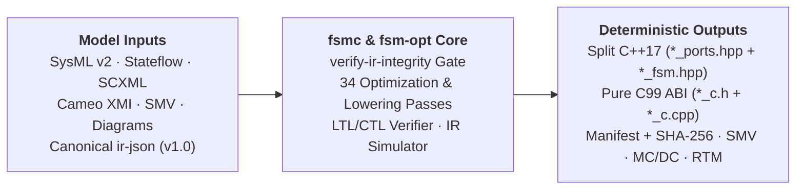

<div align="center">


# `fsmc`

[](https://github.com/simoneCavalleri/fsmc/actions/workflows/ci.yml)
[](https://simoneCavalleri.github.io/fsmc/)
[](https://github.com/simoneCavalleri/fsmc/releases)
[](LICENSE)
[](https://simoneCavalleri.github.io/fsmc/formal_languages/uml_reference/)
[](https://simoneCavalleri.github.io/fsmc/reference/test_suite_catalog/)

**The Universal, Zero-Dependency State Machine Compiler & Formal Verification Engine.**  
*Compile formal statecharts into verified, zero-heap C++17 and pure C99 ABI code—standalone or as the composable core of modern MBSE toolchains.*

[Documentation](https://simoneCavalleri.github.io/fsmc/) • [Quickstart](https://simoneCavalleri.github.io/fsmc/getting_started/quickstart/) • [CLI Reference](https://simoneCavalleri.github.io/fsmc/getting_started/cli_usage/) • [Runtime API](https://simoneCavalleri.github.io/fsmc/runtime_api/synchronous_fsm/) • [Examples](examples/) • [Changelog](CHANGELOG.md)

</div>

---

## Why `fsmc`?

Safety-critical and embedded control software should not rely on hand-coded `switch` statements that drift from architectural models, nor on heavy code generators that drag in runtime dependencies, heap allocations, and opaque tool lock-in.

**`fsmc`** is a deterministic, zero-dependency compiler that turns statechart specifications into formally verified, zero-overhead production code:

- **Formally Verified Before Codegen**: Built-in LTL/CTL model checking, EFSM interval analysis, deadlock/livelock detection, WCET bounds, interactive IR simulation (`--simulate`), MC/DC GoogleTest synthesis, and Requirement Traceability Matrices (RTM).
- **Zero-Overhead Deterministic Runtimes**: Unified C++17 backend (compiling cleanly in C++17, C++20, and C++23, plus `--freestanding` `-fno-exceptions -fno-rtti`) with **0 bytes heap**, **0 vtables** on hot paths, $O(1)$ dispatch, lock-free SPSC, thread-safe MPSC, deterministic timers, and zero-heap snapshot rollback.
- **Pure C99 Zero-Alloc ABI (`--emit-c-abi`)**: Generates strict C99 (`-pedantic -Werror`) `extern "C"` headers with statically aligned opaque storage, flat POD ports, C callback service tables (`void* user_data`), and placement-new C++17 bridges—ready for C, Rust, Python, and legacy C++ callers.
- **Composable by Design**: Designed as the deterministic backend of modern MBSE toolchains—with strict canonical `ir-json` ingestion (`--input-format=ir-json`), a mandatory `verify-ir-integrity` gate, split `*_ports.hpp` + `*_fsm.hpp` headers for HAL isolation, language-agnostic external type references (`external_ref`), compile-time `ServicesContract` verification, SHA-256 attested `*.manifest.json`, and machine-readable `--diagnostics=json`.



---

## Core Capabilities

| Area | Highlights | Guide |
| :--- | :--- | :--- |
| **9 Modeling Formats + `ir-json`** | OMG SysML v2, MathWorks Stateflow (`.xml`/`.slx`), W3C SCXML, Cameo XMI 2.1, nuXmv SMV, PlantUML, Mermaid, Graphviz DOT, XState JSON, and strict canonical `ir-json` (`schemas/fsm_ir.schema.json`). | [Modeling Languages](https://simoneCavalleri.github.io/fsmc/formal_languages/sysml_v2/) |
| **Middle-End & `fsm-opt`** | Mandatory `verify-ir-integrity` gate, 34 registered passes (7-stage verified pipeline, guard simplification, dead-state pruning, orthogonal product, connective junction chaining), `--pipe-through`, and dynamic C++ plugins. | [Middle-End Passes](https://simoneCavalleri.github.io/fsmc/internals/middleend_passes/) |
| **Verification & IR Simulation** | Native LTL/CTL model checker, EFSM interval analysis with widening $\nabla$, interactive IR trace simulator (`--simulate --trace`), counterexample GoogleTest export (`--export-cex-gtest`), MC/DC synthesis, and RTM. | [Verification & Simulation](https://simoneCavalleri.github.io/fsmc/verification_and_safety/ir_simulation/) |
| **4-Domain Memory Isolation** | Strict separation of `InPorts` (read-only), `OutPorts` (write-only), `Registers` ($z^{-1}$ internal state), and `Services` (typed, zero-vtable injected dependencies validated via `<Model>ServicesContract<Srv>`). | [Guards & Actions](https://simoneCavalleri.github.io/fsmc/concepts/guards_and_actions/) |
| **Split Headers, External PODs & C99 ABI** | Default split emission (`*_ports.hpp` with zero `fsm.hpp` dependency + `*_fsm.hpp`), `--standalone` single-header mode, language-agnostic `external_ref` shared PODs, and zero-alloc `--emit-c-abi`. | [Split Headers & C99 ABI](https://simoneCavalleri.github.io/fsmc/runtime_api/c_abi_and_split_interfaces/) |
| **Manifests & Structured Diagnostics** | `--emit-manifest` produces `*.manifest.json` (`schemas/fsm_manifest.schema.json`) with cross-artifact FIPS 180-4 `ir_sha256` attestation; `--diagnostics=json` outputs structured errors, counterexamples, and suggested fixes. | [CLI Reference](https://simoneCavalleri.github.io/fsmc/getting_started/cli_usage/) |

---

## Quickstart

### 1. Build & Install

```bash
cmake -B build -DCMAKE_BUILD_TYPE=Release
cmake --build build -j$(nproc)
sudo cmake --install build
```

*Also available via CMake `FetchContent`, `vcpkg`, and Conan 2.0 — see the [Installation Guide](https://simoneCavalleri.github.io/fsmc/getting_started/installation/).*

### 2. Verify, Simulate & Compile a Model

Given a SysML v2 state machine (`satellite.sysml`):

```sysml
state def SatelliteControl {
    in port sensor_temp : Real { assert constraint { self >= -50.0 and self <= 150.0; } }
    out port heater_power : Real { assert constraint { self >= 0.0 and self <= 100.0; } }
    attribute cycle_count : Integer = 0;

    entry; then Booting;

    state Booting;
    state Operational;
    state SafeMode;

    transition boot_ok
        first Booting
        accept EvSysInit
        do action { log("Satellite online"); }
        then Operational;

    transition overheat_fault
        first Operational
        if in.sensor_temp > 90.0
        then SafeMode;
}
```

Verify, generate split C++17 headers (`satellite_ports.hpp` + `satellite_fsm.hpp`), pure C99 ABI (`satellite_c.h` + `satellite_c.cpp`), and the SHA-256 attested manifest (`satellite.manifest.json`):

```bash
# Formal verification with structured JSON diagnostics
fsmc -i satellite.sysml --verify --diagnostics=json

# Split C++17 headers + C99 zero-alloc ABI + system manifest
fsmc -i satellite.sysml -o satellite_fsm.hpp --name SatelliteControlFSM --emit-c-abi --emit-manifest

# Or a single self-contained header
fsmc -i satellite.sysml -o satellite_fsm.hpp --standalone --name SatelliteControlFSM
```

Drive the generated FSM from C++17/20/23 (`main.cpp`):

```cpp
#include "satellite_fsm.hpp"

int main() {
    fsm_generated::SatelliteControlFSMRegisters reg{0};
    fsm_generated::SatelliteControlFSM sm(reg);
    fsm_generated::SatelliteControlFSMInPorts in{};
    in.sensor_temp = 25.0;
    fsm_generated::SatelliteControlFSMOutPorts out{};

    sm.dispatch(fsm_generated::EvSysInit{}, in, out);
    in.sensor_temp = 95.0;
    sm.step(in, out); // Transitions to SafeMode
}
```

Or optimize and exchange canonical IR directly via **`fsm-opt`** and **`--input-format=ir-json`**:

```bash
fsm-opt -i satellite.sysml --passes=dead-state-pruning,guard-simplification --emit-ir -o satellite.ir.json
fsmc --input-format=ir-json -i satellite.ir.json -o satellite_fsm.hpp --emit-manifest
```

---

## Documentation

Full documentation is hosted at **[simoneCavalleri.github.io/fsmc](https://simoneCavalleri.github.io/fsmc/)**:

- **[Getting Started](https://simoneCavalleri.github.io/fsmc/getting_started/installation/)**: Installation, Quickstart Tutorial, CLI Reference (`fsmc` & `fsm-opt`), CMake Integration.
- **[Core Concepts](https://simoneCavalleri.github.io/fsmc/concepts/states_and_hierarchy/)**: HFSM Hierarchy, Transitions, 4-Domain Memory Model, Execution Semantics.
- **[Formal Languages](https://simoneCavalleri.github.io/fsmc/formal_languages/sysml_v2/)**: SysML v2, Stateflow, SCXML, Cameo XMI, nuXmv SMV, PlantUML, Mermaid, DOT.
- **[Verification & Simulation](https://simoneCavalleri.github.io/fsmc/verification_and_safety/model_checking/)**: LTL/CTL Model Checking, Interactive IR Simulation, Interval Analysis, MC/DC Synthesis, RTM.
- **[Runtime & C99 ABI](https://simoneCavalleri.github.io/fsmc/runtime_api/synchronous_fsm/)**: Synchronous `fsm`, Lock-Free `spsc_fsm`, Thread-Safe `thread_safe_fsm`, Split Interfaces & C99 ABI.
- **[Compiler Internals](https://simoneCavalleri.github.io/fsmc/internals/architecture/)**: Pipeline Architecture, 34 Middle-End Passes, Canonical `FsmIr` Schema, Test Suite Catalog.

---

## License

`fsmc` is open-source software licensed under the [MIT License](LICENSE).
