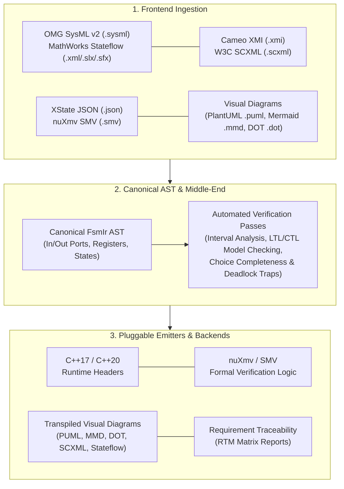

# Modeling Languages & Formats

`fsmc` features a multi-format frontend and backend pipeline supporting **9 modeling and interchange formats** across Model-Based Systems Engineering (MBSE), formal verification, and visual diagramming.

---

## 1. Format Selection Decision Guide

| Format | Category | Best Used When... | Reference Guide |
| :--- | :--- | :--- | :--- |
| **OMG SysML v2** (`.sysml`) | Formal MBSE | Authoring new safety-critical or embedded state machines with native ports, constraints, and LTL/CTL properties. | [SysML v2 Guide](sysml_v2.md) |
| **MathWorks Stateflow** (`.slx`, `.sfx`, `.xml`) | Industrial Control | Migrating or compiling existing Simulink Stateflow charts into zero-allocation C++ without commercial codegen toolboxes. | [Stateflow Guide](stateflow.md) |
| **Cameo / MagicDraw** (`.xmi`, `.xml`) | CASE MBSE | Compiling XMI 2.1 models exported from Dassault Systèmes Cameo Systems Modeler or MagicDraw. | [Cameo XMI Guide](cameo_magicdraw.md) |
| **W3C SCXML** (`.scxml`) | Standards / Exchange | Interchanging statecharts with standard SCXML tooling, datamodels, and parallel `<parallel>` regions. | [W3C SCXML Guide](scxml.md) |
| **XState JSON** (`.json`) | Formal / Web Statecharts | Sharing structured JSON statecharts across TypeScript/UI workflows and C++ embedded controllers. | [UML & Feature Matrix](uml_reference.md) |
| **nuXmv / SMV** (`.smv`) | Formal Verification | Exporting symbolic Kripke models (`--export smv`) for exhaustive BDD/BMC proof in external nuXmv / NuSMV. | [nuXmv / SMV Guide](smv_nuxmv.md) |
| **PlantUML** (`.puml`) | Visual Diagram | Maintaining lightweight review diagrams enriched with `@fsm:*` comment directives or `.fsm.yaml` sidecars. | [Diagrams Guide](diagrams.md) |
| **Mermaid** (`.mmd`) | Visual Diagram | Rendering `stateDiagram-v2` charts natively in GitHub Markdown, wikis, and PRs. | [Diagrams Guide](diagrams.md) |
| **Graphviz DOT** (`.dot`, `.gv`) | Visual Diagram | Inspecting compiled/flattened topology graphs and structural metrics. | [Diagrams Guide](diagrams.md) |
| **UML 2.5 Cross-Reference** | Reference | Comparing exact construct mappings across SysML v2, SCXML, XState, Cameo, PlantUML, Mermaid, and DOT. | [UML Reference](uml_reference.md) |

---

## 2. Ingestion & Transpilation Architecture

`fsmc` decouples the ingestion of human-readable modeling languages from analysis passes and target code emission through its strongly typed Intermediate Representation (**`FsmIr`**):



---

## 3. Lossless Diagram Directives (`@fsm:*`)

Visual diagram languages (like PlantUML and Mermaid) are traditionally purely graphical and lack native syntax for hardware port definitions, variable memory bounds, or formal LTL invariants.

`fsmc` solves this through **Lossless Diagram Directives** (`@fsm:*`):
- Semantic annotations embedded inside standard diagram comments (`' @fsm:...` in PlantUML, `%% @fsm:...` in Mermaid, `// @fsm:...` in DOT, `<!-- @fsm:... -->` in SCXML).
- When transpiling between visual diagrams and formal MBSE models, all typed ports, memory registers, deferred events, and formal safety properties are **preserved without semantic loss**.
- Detailed syntax and examples are available in the [Visual Diagrams & Directives Guide](diagrams.md).

---

## 4. Cross-Format Feature Matrix

| Feature | SysML v2 | Stateflow | Cameo XMI | W3C SCXML | XState JSON | PlantUML / Mermaid / DOT | nuXmv / SMV |
| :--- | :--- | :--- | :--- | :--- | :--- | :--- | :--- |
| **Frontend Category** | Formal | Formal | Formal | Formal | Formal | Diagram (`--allow-diagram`) | Formal |
| **Hierarchical States (HFSM)** | `state def { ... }` | `EXCLUSIVE_OR` | `uml:Region` | `<state><state/></state>` | Nested `states` | `state P { ... }` / `subgraph` | Flattened states |
| **Choice / Connective Junctions** | `choice Branch;` | `CONNECTIVE` | `uml:Pseudostate` | `<transition cond="...">` | `cond` array | `<<choice>>` / `shape=diamond` | `case ... esac` |
| **Shallow & Deep History** | `[H]`, `[H*]` | `HISTORY` | `uml:Pseudostate` | `<history type="deep"/>` | `type: "history"` | `[H]`, `[H*]` | $z^{-1}$ memory var |
| **Hardware Ports (`In`/`Out`)** | `in/out port` + `assert` | `<!-- @fsm:port -->` | `uml:Port` | `<!-- @fsm:port -->` | `@fsm:port` / sidecar | `@fsm:port` / sidecar | Bounded `VAR` |
| **Internal Memory (`Registers`)** | `attribute` | `<!-- @fsm:register -->` | `uml:Property` | `<datamodel>` | `context` | `@fsm:var` / sidecar | `VAR` + `next()` |
| **Timed Dwell Transitions** | `after 500 ms` | `after(N, msec)` | `TimeTrigger` | `<transition delay="...">` | `after: { ... }` | `after(500ms)` / `after_500ms` | `timer : 0..500` |
| **Deferred Events** | `defer Evt;` | `@fsm:defer` | `<<deferred>>` | `<defer event="..."/>` | `"defer": [...]` | `@fsm:defer [Evt]` | Discrete Event Queue |
| **Safety & Liveness (LTL/CTL)** | `assert property` / `// @fsm:property` | `<!-- @fsm:property -->` | Stereotype / comment | `<!-- @fsm:property -->` | `@fsm:property` | `@fsm:property` | `INVARSPEC` / `LTLSPEC` / `CTLSPEC` |
| **Requirement Traceability** | `satisfy requirement REQ;` | `<!-- @fsm:state satisfies=[...] -->` | `<<Satisfy>>` | `satisfies="..."` | `@fsm:state satisfies=[...]` | `@fsm:state satisfies=[...]` | Traceability Matrix |

---

## 5. Universal CLI Transpilation

Transpile losslessly between any supported formats using `--export <format>`:

```bash
# Transpile SysML v2 to Mermaid for documentation and web wikis
fsmc -i flight_control.sysml --export mermaid -o flight_control.mmd

# Transpile PlantUML into W3C SCXML interchange model
fsmc -i model.puml --export scxml -o model.scxml

# Transpile Cameo XMI into canonical nuXmv formal SMV logic
fsmc -i mission.xmi --export smv -o formal_verification.smv

# Export visual Graphviz DOT graph with computed layout attributes
fsmc -i flight_control.sysml --export dot -o architecture.dot
```
