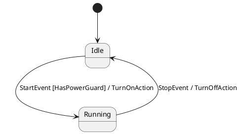
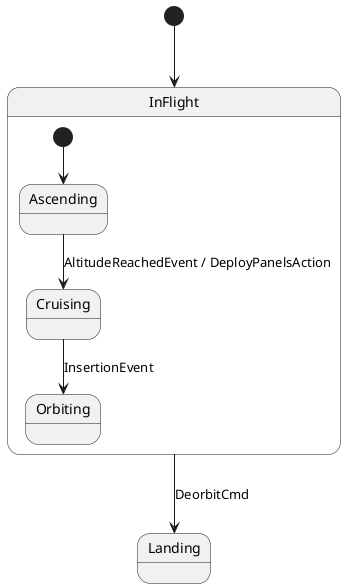
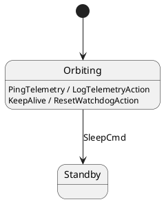
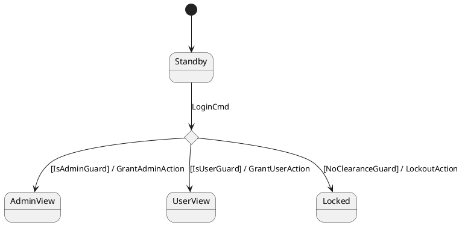
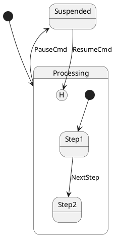
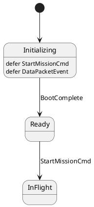
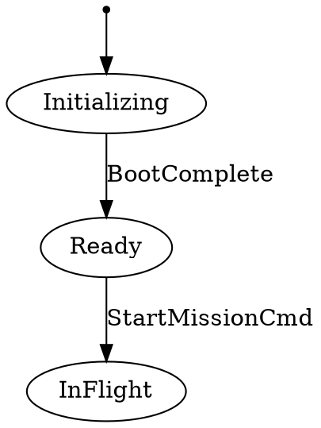

# OMG UML 2.5 & SysML v2 State Machine Reference Guide

This guide provides a comprehensive mapping between the **OMG UML 2.5 / SysML v2 State Machine Specifications** and their syntax representations in **OMG SysML v2** (`.sysml`), **PlantUML** (`@startuml`), and **Mermaid** (`stateDiagram-v2`), along with the corresponding C++ code generated by **`fsmc`**.

---

## 1. Simple States & Transitions


### OMG SysML v2 (`.sysml`)
```sysml
state def PowerSystem {
    entry; then Idle;

    state Idle;
    state Running;

    transition start_trans
        first Idle
        accept StartEvent
        if HasPowerGuard
        do TurnOnAction
        then Running;

    transition stop_trans
        first Running
        accept StopEvent
        do TurnOffAction
        then Idle;
}
```

### PlantUML (`.puml`)


### Mermaid (`.mmd`)
```mmd
stateDiagram-v2
    [*] --> Idle
    Idle --> Running : StartEvent [HasPowerGuard] / TurnOnAction
    Running --> Idle : StopEvent / TurnOffAction
```


### Generated C++ Row
```cpp
fsm::row<Idle, StartEvent, Running, HasPowerGuard, TurnOnAction>
```

---

## 2. Hierarchical / Composite States (HFSM)

### OMG SysML v2 (`.sysml`)
```sysml
state def FlightSystem {
    entry; then InFlight;

    state InFlight {
        entry; then Ascending;
        state Ascending;
        state Cruising;
        state Orbiting;
    }

    state Landing;

    transition from Ascending accept AltitudeReachedEvent do DeployPanelsAction then Cruising;
    transition from Cruising accept InsertionEvent then Orbiting;
    transition from InFlight accept DeorbitCmd then Landing;
}
```

### PlantUML (`.puml`)


### Mermaid (`.mmd`)
```mmd
stateDiagram-v2
    [*] --> InFlight

    state InFlight {
        [*] --> Ascending
        Ascending --> Cruising : AltitudeReachedEvent / DeployPanelsAction
        Cruising --> Orbiting : InsertionEvent
    }

    InFlight --> Landing : DeorbitCmd
```


---

## 3. Internal Transitions

Internal transitions execute actions without triggering `on_exit` or `on_enter` on the current state.

### OMG SysML v2 (`.sysml`)
```sysml
state def Satellite {
    entry; then Orbiting;
    state Orbiting;

    // Internal transition: no 'then/to' target
    transition from Orbiting accept PingTelemetry do LogTelemetryAction;
}
```

### PlantUML (`.puml`)


### Mermaid (`.mmd`)
```mmd
stateDiagram-v2
    [*] --> Orbiting

    Orbiting : PingTelemetry / LogTelemetryAction
    Orbiting : KeepAlive / ResetWatchdogAction
    Orbiting --> Standby : SleepCmd
```


### Generated C++ Row
```cpp
fsm::internal_row<Orbiting, PingTelemetry, fsm::no_guard, LogTelemetryAction>
```

---

## 4. Choice & Junction Pseudostates

### OMG SysML v2 (`.sysml`)
```sysml
state def Authentication {
    entry; then Standby;

    state Standby;
    state AuthChoice :> Choice;
    state AdminView;
    state UserView;
    state Locked;

    transition from Standby accept LoginCmd then AuthChoice;
    transition from AuthChoice if IsAdminGuard do GrantAdminAction then AdminView;
    transition from AuthChoice if IsUserGuard do GrantUserAction then UserView;
    transition from AuthChoice if NoClearanceGuard do LockoutAction then Locked;
}
```

### PlantUML (`.puml`)


### Mermaid (`.mmd`)
```mmd
stateDiagram-v2
    [*] --> Standby

    state AuthChoice <<choice>>

    Standby --> AuthChoice : LoginCmd
    AuthChoice --> AdminView : [IsAdminGuard] / GrantAdminAction
    AuthChoice --> UserView : [IsUserGuard] / GrantUserAction
    AuthChoice --> Locked : [NoClearanceGuard] / LockoutAction
```

---

## 5. History States (Shallow & Deep)

| Symbol | Name | Description |
| :---: | :--- | :--- |
| `State[H]` | **Shallow History** | Restores the most recent direct active sub-state of `State`. |
| `State[H*]` | **Deep History** | Recursively restores the most recent active sub-state across all nested levels. |

### OMG SysML v2 (`.sysml`)
```sysml
state def TaskManager {
    entry; then Processing;

    state Processing {
        entry; then Step1;
        state Step1;
        state Step2;
    }

    state Suspended;

    transition from Step1 accept NextStep then Step2;
    transition from Processing accept PauseCmd then Suspended;
    transition from Suspended accept ResumeCmd then Processing[H];
}
```

### PlantUML (`.puml`)


---

## 6. Deferred Events

### OMG SysML v2 (`.sysml`)
```sysml
state def BootSequence {
    entry; then Initializing;

    state Initializing;
    defer StartMissionCmd;
    defer DataPacketEvent;

    state Ready;
    state InFlight;

    transition from Initializing accept BootComplete then Ready;
    transition from Ready accept StartMissionCmd then InFlight;
}
```

### PlantUML (`.puml`)


### Mermaid (`.mmd`)
```mmd
stateDiagram-v2
    [*] --> Initializing

    Initializing : [defer] StartMissionCmd
    Initializing : [defer] DataPacketEvent

    Initializing --> Ready : BootComplete
    Ready --> InFlight : StartMissionCmd
```


### Graphviz DOT (`.dot`, `.gv`)


### Cameo / MagicDraw (`.xmi`)
```xml
<subvertex xmi:type="uml:State" xmi:id="_init" name="Initializing">
  <deferrableTrigger xmi:type="uml:Trigger" xmi:id="_dt1" name="StartMissionCmd"/>
</subvertex>
```

### W3C SCXML (`.scxml`)
```xml
<state id="Initializing">
  <defer event="StartMissionCmd"/>
  <transition event="BootComplete" target="Ready"/>
</state>
```

### XState JSON (`.json`)
```json
{
  "Initializing": {
    "defer": ["StartMissionCmd", "DataPacketEvent"],
    "on": { "BootComplete": "Ready" }
  }
}
```

### Generated C++ State
```cpp
struct Initializing {
    static constexpr std::string_view name = "Initializing";
    using deferred_events = fsm::type_list<StartMissionCmd, DataPacketEvent>;
};
```
*When `Initializing` transitions to `Ready`, queued events are automatically replayed in FIFO order.*

---

## 7. Timed Transitions

`fsmc` provides first-class support for deterministic timer-based transitions and deadline scheduling:

### Type-Safe Timed Events
```cpp
// Explicit compile-time duration events:
using Timeout500ms = fsm::after_ms<500>;
using Timeout10s   = fsm::after_s<10>;
using Timeout50us  = fsm::after_us<50>;

// Transition definition in table:
fsm::transition<Connecting, Timeout500ms, Disconnected, OnTimeoutAction>
```

### Asynchronous Deadline Scheduling (`thread_safe_fsm`)
```cpp
fsm::thread_safe_fsm<MyTable, MyInPorts, MyOutPorts, MyRegisters, MyServices> sm(reg, srv);
sm.start_worker();

// Schedule delayed events executed by worker in strict chronological priority:
sm.post_delayed(TimeoutEvent{}, std::chrono::milliseconds(500));
```

---

## 8. Universal Diagram Export & Translation

Translate any model format to **Mermaid**, **PlantUML**, or **OMG SysML v2**:

```bash
# Convert Cameo XMI to GitHub-renderable Mermaid
fsmc -i model.xmi --export mermaid -o diagram.mmd

# Convert W3C SCXML to PlantUML
fsmc -i protocol.scxml --export plantuml -o protocol.puml

# Convert PlantUML to OMG SysML v2 textual specification
fsmc -i mission.puml --export sysml2 -o mission.sysml
```

---

## 9. Guards, Composite Logic & Actions

### Composite Boolean Guards (`!`, `&&`, `||`)
`fsmc` features a built-in recursive expression parser for composite guards across all supported model formats. You can write arbitrary boolean logic directly in transitions:

| Expression in Diagram | Generated C++ Guard Type | Semantics |
| :--- | :--- | :--- |
| `[!EmergencyStop]` | `fsm::not_<EmergencyStop>` | Logical NOT |
| `[PowerOk && DoorClosed]` | `fsm::and_<PowerOk, DoorClosed>` | Logical AND (Short-circuit) |
| `[HasKey || IsAdmin]` | `fsm::or_<HasKey, IsAdmin>` | Logical OR (Short-circuit) |
| `[PowerOk && (!Fault || Override)]` | `fsm::and_<PowerOk, fsm::or_<fsm::not_<Fault>, Override>>` | Nested grouping |

#### Multi-Format Syntax:
- **PlantUML / Mermaid / DOT**: `StateA --> StateB : Event [PowerOk && !EmergencyStop]`
- **SysML v2**: `transition from StateA accept Event if PowerOk && !EmergencyStop then StateB;`
- **SCXML**: `<transition event="Event" cond="PowerOk &amp;&amp; !EmergencyStop" target="StateB"/>`
- **XState JSON**: `"guard": "PowerOk && !EmergencyStop"`

When generating C++ code, `fsmc` generates stub definitions only for atomic predicates (`PowerOk`, `EmergencyStop`), combining them seamlessly through `fsm::and_`, `fsm::or_`, `fsm::not_`.

### C++ Guard Signature (Predicates)
```cpp
struct ValidClearanceGuard {
    [[nodiscard]] constexpr bool operator()(const AuthorizeCmd& cmd,
                                            const MissionInPorts& in,
                                            const MissionRegisters& reg) const noexcept {
        return cmd.is_valid() && in.flight_clearance_granted;
    }
};
```

### C++ Action Signature
```cpp
struct DeploySolarPanelsAction {
    void operator()(MissionOutPorts& out,
                    MissionRegisters& reg,
                    MissionServices& srv) const {
        out.solar_panels_deployed = true;
        reg.deployment_cycle += 1;
        srv.notify_ground_station("Solar panels deployed");
    }
};
```

## 10. Format Feature Matrix & Extensions Specification

### A. Frontend Classification (Formal Models vs. Visual Diagrams)

`fsmc` categorizes input formats into two frontend classes:

1. **Formal Metamodels (`include/fsm/frontend/formal/`)**:
   - **OMG SysML v2** (`.sysml`), **MathWorks Stateflow** (`.slx`, `.sfx`, `.xml`), **Cameo / MagicDraw** (`.xmi`), **W3C SCXML** (`.scxml`), **nuXmv / SMV** (`.smv`), and **XState JSON** (`.json`).
   - Explicit symbol declarations and typed semantics. Direct C++ compilation is enabled without extra flags.
2. **Visual Diagrams (`include/fsm/frontend/diagram/`)**:
   - **PlantUML** (`.puml`), **Mermaid `stateDiagram-v2`** (`.mmd`), and **Graphviz DOT** (`.dot`, `.gv`).
   - Sketch notations designed for documentation and review; direct C++ generation requires `--allow-diagram` (or `--allow-diagram-codegen`). See the individual format guides for [Cameo XMI](cameo_magicdraw.md), [W3C SCXML](scxml.md), [Stateflow](stateflow.md), and [Visual Diagrams](diagrams.md).

### B. Feature Matrix (Native vs. Extended Syntax)

| Feature / Concept | Cameo OMG XMI | OMG SysML v2 | Stateflow | W3C SCXML | XState JSON | PlantUML | Mermaid | Graphviz DOT |
| :--- | :---: | :---: | :---: | :---: | :---: | :---: | :---: | :---: |
| **Frontend Category** | **Formal** | **Formal** | **Formal** | **Formal** | **Formal** | **Diagram** | **Diagram** | **Diagram** |
| **Simple States & Transitions** | Native | Native | Native | Native | Native | Native | Native | Native |
| **Initial / Final States** | Native | Native | Native | Native | Native | Native (`[*]`) | Native (`[*]`) | Extended (`shape=point`) |
| **Composite States (HFSM)** | Native | Native | Native (`EXCLUSIVE_OR`) | Native | Native | Native | Native | Extended (`subgraph`) |
| **Internal Transitions** | Native | Native | Native | Native | Native | Native (`State : E / A`) | Native (`State : E / A`) | Extended (`internal=true`) |
| **Choice / Junction** | Native | Native | Native (`CONNECTIVE`) | Extended (`cond` list) | Extended (`cond` list) | Native (`<<choice>>`) | Native (`<<choice>>`) | Extended (`shape=diamond`) |
| **History States (`[H]`, `[H*]`)** | Native | Native (`[H]`, `[H*]`) | Native (`HISTORY`) | Native | Native (`type: "history"`) | Native (`State[H]`) | Extended (`[H]`) | *N/A* |
| **Deferred Events** | Native | Native (`defer Evt;`) | Extended (`@fsm:defer`) | Extended (`<defer>`) | Native (`"defer": []`) | Extended (`: defer Evt`) | Extended (`: [defer] Evt`) | Extended (`defer="..."`) |
| **Composite Guards (`!`, `&&`, `||`)** | Extended (AST) | Native (`and`/`&&`, `or`/`||`, `not`/`!`) | Native | Native | Native | Extended (AST) | Extended (AST) | Extended (AST) |
| **Timed Transitions (`after_ms<N>`)** | Extended (AST) | Native (`after 500 ms`) | Native (`after(500, msec)`) | Native (`delay=...`) | Native (`after: {}`) | Extended (AST) | Extended (AST) | Extended (AST) |
| **Comment Directives** | *N/A* | `// @fsm:...` | `<!-- @fsm:... -->` | `<!-- @fsm:... -->` | `@fsm:...` / sidecar | `' @fsm:...` | `%% @fsm:...` | `// @fsm:...` |

### C. Extension Design Principles

When a visual format lacks a native keyword for UML 2.5 constructs (such as deferred events or timed transitions), `fsmc` extensions follow three principles:

1. **Renderer-Safe (Non-Intrusive)**: Extensions never break standard diagram renderers (PlantUML JAR, Mermaid.js CLI, Graphviz `dot`), rendering cleanly as notes, attributes, or stereotypes.
2. **Deterministic Parsing**: The parser evaluates input through explicit grammar and token matching rather than heuristic guessing.
3. **Zero-Overhead Lowering**: Features omitted from a model emit no extra runtime structures or branches in generated C++.

For the complete comment-directive syntax (`@fsm:port`, `@fsm:var`, `@fsm:signal`, `@fsm:property`, `@fsm:defer`, `@fsm:state`, `@fsm:submachine`), see [Visual Diagrams & Directives](diagrams.md).

### D. Timed Transitions (`after(...)`, `every(...)`) & SMV Discrete Timers

- **OMG SysML v2**: `transition accept after 500 ms then NextState;`
- **MathWorks Stateflow**: `after(500, msec)` or `after(0.5, sec)`
- **W3C SCXML**: `<transition delay="500ms" target="NextState"/>`
- **XState JSON**: `"after": { "500": "NextState" }`
- **PlantUML / Mermaid / DOT**: `after_500ms`, `after_10s`, `after_50us`, `after(500ms)`, `every(100ms)`
- **SMV Formal Synthesis**: The SMV serializer allocates discrete tick counters (`timer_<State> : 0..<duration>;`) and resets them on transition entry.

### E. Static Semantic Validation Summary

After parsing any input format, the validation passes verify:

- **Reachability Analysis**: Identifies states unreachable from the initial state.
- **Target Integrity**: Verifies that all transition targets and composite parents resolve to valid states.
- **Initial State Determinism**: Ensures every composite region has a well-defined initial entry transition.
- **Choice Branch Completeness**: Ensures choice pseudostates possess valid outgoing branches.
- **Identifier Sanitization**: Normalizes identifiers to valid C++ symbols while preserving trace names.


