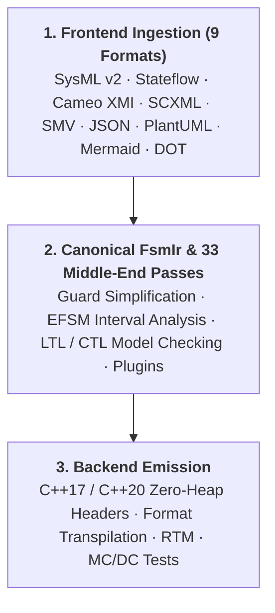

---
hide:
  - navigation
---

<div class="fsmc-hero" markdown="1">
<div class="fsmc-hero__badge">v0.9.0 &middot; C++17 / C++20 &middot; Zero-Heap Runtime &middot; LTL / CTL</div>

# Universal State Machine Compiler

**`fsmc`** bridges Model-Based Systems Engineering (**OMG SysML v2**, **MathWorks Stateflow**, **W3C SCXML**, **Cameo XMI**, **nuXmv SMV**) and visual diagrams with formal verification and zero-allocation C++ execution runtimes—unified through the canonical **`FsmIr`** intermediate representation.

<div class="fsmc-hero__actions" markdown="1">
[Quickstart Guide](getting_started/quickstart.md){ .md-button .md-button--primary }
[Step-by-Step Tutorials](tutorials/index.md){ .md-button }
</div>
</div>

---

## Why Engineers Choose `fsmc`

<div class="grid cards" markdown>

-   :material-translate:{ .lg .middle } **9 Modeling Frontends, 1 IR**

    ---

    Ingest SysML v2, Stateflow XML, Cameo XMI 2.1, SCXML, SMV, JSON, PlantUML, Mermaid, or Graphviz DOT into a single canonical `FsmIr` graph—and transpile cleanly across notations.

    [:octicons-arrow-right-24: Modeling Languages](formal_languages/index.md)

-   :material-shield-check-outline:{ .lg .middle } **Built-In Formal Verification**

    ---

    Check deadlocks, reachability, interval guard satisfiability, WCET bounds, and LTL/CTL temporal properties natively—or export directly to **nuXmv**, **RTM matrices**, and **MC/DC** GoogleTest harnesses.

    [:octicons-arrow-right-24: Verification & Safety](verification_and_safety/index.md)

-   :material-memory:{ .lg .middle } **Zero-Heap C++17 / C++20 Runtime**

    ---

    Compile-time transition tables with strict 4-domain isolation (`InPorts`, `OutPorts`, `Registers`, `Services`), zero virtual dispatch on hot paths, synchronous, lock-free SPSC, and thread-safe modes.

    [:octicons-arrow-right-24: C++ Runtime Backend](runtime_api/index.md)

-   :material-cogs:{ .lg .middle } **33 Middle-End Compiler Passes**

    ---

    Run deterministic optimization, orthogonal product flattening, connective junction chaining, submachine inlining, dynamic C++ plugins, and Unix filter pipelines via `fsm-opt`.

    [:octicons-arrow-right-24: Middle-End Passes](internals/middleend_passes.md)

</div>

---

## Compiler Pipeline Architecture



### Compiler Subsystems

1. **Frontend Ingestion**: Parses statechart models from 9 formats (OMG SysML v2, W3C SCXML, MathWorks Stateflow XML / SLX, Cameo XMI 2.1, nuXmv SMV, PlantUML, Mermaid, Graphviz DOT, and Canonical JSON) into the unified `FsmIr` AST.
2. **Middle-End Analysis & Formal Verification**:
    - **Pass Optimization & Analysis Pipeline**: Orchestrated by **`fsmc`** and **`fsm-opt`**, registering 33 transformation passes (28 in the verified 7-stage pipeline, plus `-O1`/`-O2` optimizations, dynamic C++ plugins, and `--pipe-through` filters) covering dead-state pruning, determinism enforcement, guard simplification, constant folding, Cartesian orthogonal product flattening, WCET / Zeno-cycle checks, submachine inlining, sampled change triggers, and connective junction chaining.
    - **Extensibility**: Unix filter pipeline (`--pipe-through <cmd>`) streaming JSON AST over stdin/stdout, and dynamic runtime C++ pass plugin loading (`--load-pass-plugin <path.so>`).
    - **EFSM Invariant & Guard Analysis**: Evaluates datapath contracts, range constraints, and guard satisfiability via static abstract interpretation over interval lattices with formal Widening ($\nabla$) and dead transition pruning.
    - **Symbolic Model Checking**: Proves temporal safety and liveness formulas specified in Linear Temporal Logic (LTL) and Computation Tree Logic (CTL) natively via fixed-point evaluation and exports to nuXmv / SMV.
3. **Backend Target Emission**:
    - **Model Transpilation**: Converts models losslessly between supported representation formats (SysML v2, SCXML, PlantUML, Mermaid, DOT, Stateflow).
    - **Formal Logic Emitters**: Generates symbolic transition systems for external model checkers (SMV / nuXmv).
    - **Safety & Verification Synthesis**: Synthesizes standalone GoogleTest C++ harnesses verifying Modified Condition / Decision Coverage (MC/DC) for safety-critical certification (DO-178C / ISO 26262).
    - **Traceability Matrices**: Generates formal Requirement Traceability Matrices (RTM) in Markdown and JSON from `satisfy requirement` and `@fsm:state satisfies` annotations.
    - **Target Code Generation**: Emits standalone, zero-heap C++17 or C++20 header files with strict 4-domain memory partitioning (`InPorts`, `OutPorts`, `Registers`, `Services`), deterministic real-time timer (`tick(dt)`), continuous `do_activity`, dual actions (`fsm::seq_`), circular flight recorder buffer, and `fsm::snapshot_recorder` for zero-heap time-travel state rollbacks.

---

## Core Capabilities

| Capability | Description | Reference Documentation |
| :--- | :--- | :--- |
| **Universal Transpilation** | Ingest any supported format across 9 MBSE, formal, and visual notations, and export to any target format (including Stateflow XML). | [Modeling Languages](formal_languages/index.md) |
| **Formal Model Checking (LTL & CTL)** | Prove temporal safety properties (LTL/CTL) natively via fixed-point evaluation and abstract interpretation without external dependencies. | [Verification & Safety](verification_and_safety/index.md) |
| **Middle-End Passes & Optimizer (`fsm-opt`)** | 33 registered passes (28 across the 7-stage verified pipeline), connective junction chaining, dead-state pruning, Cartesian product flattening, WCET bounds, Unix filters (`--pipe-through`), and C++ plugins. | [Middle-End Passes](internals/middleend_passes.md) |
| **Safety & Test Synthesis (MC/DC)** | Synthesize GoogleTest suites certifying Modified Condition / Decision Coverage for DO-178C / ISO 26262 compliance. | [MC/DC Synthesis](verification_and_safety/mcdc_synthesis.md) |
| **Partitioned Memory Model** | Replaces unstructured context objects with 4 segregated domains: `InPorts`, `OutPorts`, `Registers`, and `Services`. | [Core Concepts](concepts/index.md) |
| **Deterministic Execution** | C++ reference backend operates with 0 bytes heap allocation, 0 virtual tables, deterministic timer (`tick(dt)`), continuous `do_activity`, and $O(1)$ dispatch time. | [Memory & Real-Time](runtime_api/memory_and_realtime.md) |
| **Zero-Heap Time-Travel Rollback** | Integrated `fsm::snapshot_recorder<Capacity, MaxSize>` circular buffer for state checkpointing, HIL fault injection recovery, and time-travel replay. | [Introspection & Trace](runtime_api/introspection_trace.md) |

---

## Core Workflow at a Glance

```bash
# 1. Formally verify structural soundness and temporal invariants (LTL / CTL)
fsmc -i mission.sysml --verify

# 2. Export Requirement Traceability Matrix or MC/DC GoogleTest harness
fsmc -i mission.sysml --rtm-output rtm_matrix.md --harness mission_mcdc_test.cpp

# 3. Compile to a standalone zero-heap C++20 header (C++17 also supported)
fsmc -i mission.sysml -o mission_fsm.hpp --std 20 --standalone --namespace mission
```

In your C++ application, interact strictly through the segregated 4-domain boundary (`InPorts`, `OutPorts`, `Registers`, `Services`):

```cpp
#include "mission_fsm.hpp"

int main() {
    mission::MissionFSMRegisters reg{};
    mission::MissionFSM sm(reg);

    mission::MissionFSMInPorts in{};
    mission::MissionFSMOutPorts out{};

    sm.dispatch(mission::CalibrateOk{}, in, out); // Reactive transition
    sm.step(in, out);                             // Periodic control step
}
```

Ready to get started? Follow the **[Quickstart Tutorial](getting_started/quickstart.md)** for a complete runnable project, or see the **[Multi-Target Roadmap](runtime_api/multi_target_roadmap.md)** for planned Rust (`no_std`) and ISO C99 backends.

---

## Documentation Roadmap

1. **[Getting Started](getting_started/index.md)**: Installation, runnable UAV quickstart, CLI flags, cheat sheet, and CMake integration.
2. **[Core Concepts](concepts/index.md)**: Dual-paradigm execution semantics (`dispatch` vs `step`), HFSM hierarchy, and the 4-domain datapath.
3. **[Step-by-Step Tutorials](tutorials/index.md)**: Progressive tutorials from basic statecharts to verification, C++ runtimes, and Stateflow Digital Twins.
4. **[Modeling & Verification](formal_languages/index.md)**: Language guides (SysML v2, Stateflow, Cameo XMI, SCXML, SMV, PlantUML, Mermaid, DOT) and [Verification Guides](verification_and_safety/index.md).
5. **[C++ Runtime Backend](runtime_api/index.md)**: Synchronous `fsm`, lock-free `spsc_fsm`, async `thread_safe_fsm`, flight recorder, and snapshot replay.
6. **[Technical Reference](reference/index.md)**: CLI options, C++ runtime API reference, CMake macros, and test suite catalog.
7. **[Compiler Internals](internals/index.md)**: Pipeline architecture, `FsmIr` schema, 33 middle-end passes, and developer recipes.

---

## License

`fsmc` is open-source software licensed under the [MIT License](https://github.com/simoneCavalleri/fsmc/blob/main/LICENSE).
