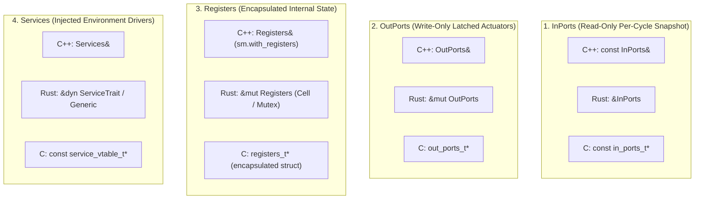

# Multi-Target Architecture & Backend Roadmap

`fsmc` is designed from first principles as a **format-agnostic compiler and code generator**, not a C++-only library. 

Its architecture strictly decouples model ingestion and formal verification from target code emission using a canonical Intermediate Representation (**`FsmIr`**). While C++ serves as the initial reference production backend, the metamodel natively maps to diverse programming languages and safety-critical execution runtimes.

!!! info "Active Production Targets vs. Roadmap Previews"
    The **Unified C++17 Reference Backend** (`--target cpp`), the **Pure C99 Zero-Allocation ABI** (`--emit-c-abi`), and the **Native Pure-C99 Bare-Metal Backend** (`--target c99`, zero C++ compiler on target) are active production targets. The native **Rust** (`no_std`) backend described below represents a **roadmap RFC design** (Rust and Python callers can already bind directly via `--target c99` or `--emit-c-abi`).

---

## 1. Universal Target Support Matrix

| Target Language | Minimum Standard | Concurrency Models | Safety & Standards Compliance | Ecosystem Status |
| :--- | :--- | :--- | :--- | :--- |
| **C++ Target (`--target cpp`)** | C++17 (compiles in C++17/20/23) | Synchronous stack, Lock-Free SPSC, Active Object | Zero heap, zero vtable, $O(1)$ WCET, `--freestanding` | **Production Target** |
| **Native Pure-C99 (`--target c99`)** | ISO C99 (`-pedantic -Werror`) | Flat switch-case dispatch, `step`, `tick`, FNV-1a snapshots, `services_t` | Zero C++ compiler/runtime, zero heap, `TargetCapabilities::c99_baremetal()` lowering | **Production Target** |
| **Pure C99 ABI (`--emit-c-abi`)** | ISO C99 (`-pedantic -Werror`) | Static aligned opaque storage + C callback `services_t` over C++17 | Zero heap (`placement-new`), `static_assert` size/align, `ir_sha256()` | **Production Target** |
| **Rust Target (Native)** | Rust 2021 (`no_std`) | Typestate transitions, lock-free static channels | Compile-time memory safety, zero panic | **Planned RFC** |

---

## 2. The Universal 4-Domain Datapath Across Languages

The `fsmc` 4-domain memory segregation model is language-agnostic. It guarantees mathematical determinism, absence of data races, and clear ownership semantics across all target architectures:



### Architectural Mapping Table

| Domain | Semantic Intent | C++ Reference Implementation | Native Pure-C99 (`--target c99`) | Planned Rust Implementation |
| :--- | :--- | :--- | :--- | :--- |
| **`InPorts`** | External sampled sensor values | `const InPorts&` | `const <prefix>_in_ports_t*` | `&InPorts` |
| **`OutPorts`** | Commanded actuator outputs + static `outbox` | `OutPorts&` | `<prefix>_out_ports_t*` | `&mut OutPorts` |
| **`Registers`** | $z^{-1}$ internal memory | Encapsulated value | `<prefix>_registers_t` struct | Struct with ownership / borrow |
| **`Services`** | Non-deterministic hardware drivers | Zero-vtable template contract | `<prefix>_services_t` callback table | Trait object / Generic bound |

---

## 3. Rust Backend (`no_std`) — Design Specification

The Rust target emitter produces idiomatic, high-performance, and provably memory-safe state machine implementations targeting embedded firmware and systems programming.

### Core Tenets
1. **`#![no_std]` First**: 100% compatible with bare-metal microcontrollers (ARM Cortex-M, RISC-V, ESP32) without dynamic memory allocation (`alloc` not required).
2. **Compile-Time Typestate Validation**: Invalid state transitions are caught at compile-time using the Rust type system.
3. **Thread Safety Guarantees**: State machines implement `Send` and `Sync` conditionally based on the thread safety of internal registers.
4. **Lock-Free Concurrency**: Asynchronous queues map to static ring buffers (e.g. `heapless::spsc::Queue`).

### Syntax Preview
```rust
// Generated Rust State Machine (Preview)
use fsmc_runtime::prelude::*;

#[derive(Clone, Copy, PartialEq, Eq)]
pub enum State { Off, On }

pub struct LampFsm {
    state: State,
    registers: LampRegisters,
}

impl LampFsm {
    pub const fn new(registers: LampRegisters) -> Self {
        Self { state: State::Off, registers }
    }

    pub fn dispatch(&mut self, event: &Event, in_ports: &InPorts, out_ports: &mut OutPorts) -> DispatchResult {
        match (self.state, event) {
            (State::Off, Event::Toggle) => {
                self.state = State::On;
                out_ports.lamp_active = true;
                DispatchResult::Transitioned
            }
            (State::On, Event::Toggle) => {
                self.state = State::Off;
                out_ports.lamp_active = false;
                DispatchResult::Transitioned
            }
            _ => DispatchResult::Ignored,
        }
    }
}
```

---

## 4. Native ISO C99 Backend (`--target c99`) — Production Overview

The native Pure-C99 target generator (`--target c99`) is an active production backend engineered for mission-critical and bare-metal microcontrollers without a C++ toolchain.

### Core Guarantees
1. **Strict ISO C99 (`-std=c99 -Wall -Wextra -Werror -pedantic`)**: Zero dynamic allocations (`malloc`/`free`), zero recursive calls, bounded loops, and clean `-Wstrict-prototypes -Wmissing-prototypes -Wshadow` compliance.
2. **Automatic Bare-Metal Lowering**: The middle-end lowers hierarchical states, history, and junctions via `TargetCapabilities::c99_baremetal()` into flat deterministic `switch-case` execution.
3. **3-Way Differential Equivalence**: Verified in CI for step-by-step equivalence (`IrSimulator == C++17 == Pure-C99`), including typed signal payloads, static `outbox` emission, timers (`_tick`), and FNV-1a checksummed binary snapshots.

### Generated C99 Interface
```c
/* Generated by: fsmc -i lamp.sysml --target c99 -o lamp.h */
#include "lamp.h"

void run_lamp(void) {
    lamp_fsm_t fsm;
    lamp_in_ports_t in_ports = { 0 };
    lamp_out_ports_t out_ports = { 0 };

    lamp_init(&fsm);
    lamp_dispatch_ev_toggle(&fsm, &in_ports, &out_ports);
    lamp_tick(&fsm, 10U, &in_ports, &out_ports);
}
```

---

## 5. Summary & Contribution

The canonical IR compiler pipeline guarantees that a model specified in **OMG SysML v2**, **Cameo / MagicDraw XMI**, or **W3C SCXML** can be formally verified once with **nuXmv** and then emitted with identical behavioral semantics in C++, Rust, or C.

For discussions on backend RFCs or to contribute target emitters, refer to the [Compiler Architecture Specification](../internals/architecture.md).
