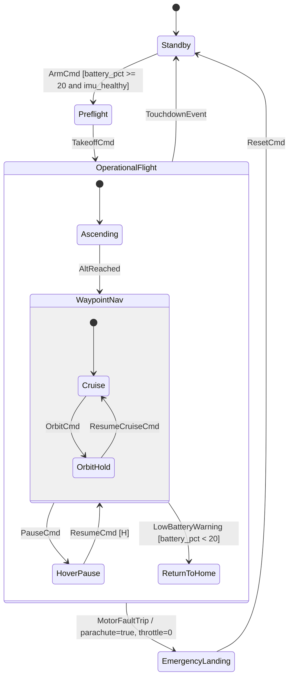

# Step 6: Complete Real-World Case Study — Autonomous UAV Flight Controller

!!! note "Curriculum Continuity"
    In **[Step 5](05_code_generation_and_integration.md)**, we covered standalone/modular builds, CMake integration, and execution runtimes. In this step, we combine modeling, partitioned EFSM ports, shallow history `[H]`, formal LTL verification, and CMake automation in an end-to-end **Autonomous UAV Flight & Mission Controller**.

We will design the system in **OMG SysML v2**, verify temporal safety properties with **`fsmc --verify`**, compile it with **CMake (`fsmc_target_sources`)**, and run a C++20 control loop.

---

## 1. System Requirements & Architecture

Our autonomous drone flight computer must satisfy the following operational requirements:



### Safety Requirements (RTM Matrix)
- **`REQ_UAV_001` (Battery Invariant)**: Motors cannot enter `Preflight` if battery level is below $20\%$ or IMU health is false.
- **`REQ_UAV_002` (Fail-Safe Disarm)**: On `MotorFaultTrip` into `EmergencyLanding`, throttle must be clamped to `0.0` and parachute deployed (`true`).
- **`REQ_UAV_003` (History Resumption)**: Resuming from `HoverPause` via `ResumeCmd` must restore the previous `WaypointNav` substate (`Cruise` or `OrbitHold`) using Shallow History `[H]`.

---

## 2. Formal SysML v2 Specification (`flight_controller.sysml`)

Here is the complete formal MBSE model specifying ports, attributes, composite states, guards, and temporal safety properties:

```sysml
// @fsm:property name=ArmSafety kind=Safety formula="G !(Standby && EmergencyLanding)" req="REQ_UAV_001"
// @fsm:property name=FailsafeReachable kind=Reachability formula="F EmergencyLanding" req="REQ_UAV_002"
state def UAVFlightController {
    // 1. Segregated InPorts (Sensor telemetry snapshot)
    in port battery_pct : Real { assert constraint { self >= 0.0 and self <= 100.0; } }
    in port altitude_m : Real;
    in port imu_healthy : Boolean;

    // 2. Segregated OutPorts (Actuator command buffer)
    out port motor_throttle : Real;
    out port parachute_deployed : Boolean;
    out port buzzer_active : Boolean;

    // 3. Persistent Registers (Datapath memory)
    attribute waypoint_index : Integer = 0;
    attribute flight_time_seconds : Integer = 0;
    attribute fault_code : Integer = 0;

    entry; then Standby;

    // 4. Statechart Topology
    state Standby;
    state Preflight {
        satisfy requirement REQ_UAV_001;
    }

    state OperationalFlight {
        entry; then Ascending;

        state Ascending;

        state WaypointNav {
            satisfy requirement REQ_UAV_003;
            entry; then Cruise;
            state Cruise;
            state OrbitHold;

            transition orbit_cmd first Cruise accept OrbitCmd then OrbitHold;
            transition resume_cruise first OrbitHold accept ResumeCruiseCmd then Cruise;
        }

        state HoverPause;
        state ReturnToHome;

        transition alt_reached first Ascending accept AltReached then WaypointNav;
        transition pause_cmd first WaypointNav accept PauseCmd then HoverPause;
        // Shallow history restoration back into Cruise or OrbitHold:
        transition resume_cmd first HoverPause accept ResumeCmd then WaypointNav[H];
        transition low_battery first WaypointNav accept LowBatteryWarning if in.battery_pct < 20.0 then ReturnToHome;
    }

    state EmergencyLanding {
        satisfy requirement REQ_UAV_002;
    }

    // Top-Level Transitions
    transition arm_cmd first Standby accept ArmCmd
        if in.battery_pct >= 20.0 and in.imu_healthy
        then Preflight;

    transition takeoff_cmd first Preflight accept TakeoffCmd then OperationalFlight;

    transition fault_trip first OperationalFlight accept MotorFaultTrip
        do action { out.parachute_deployed = true; out.motor_throttle = 0.0; }
        then EmergencyLanding;

    transition land_complete first OperationalFlight accept TouchdownEvent then Standby;
    transition reset_complete first EmergencyLanding accept ResetCmd then Standby;
}
```

---

## 3. Formal Safety Verification

Before generating code, verify the formal model against LTL safety temporal properties using `fsmc`:

```bash
# Verify graph invariants, event queue bounds, WCET, and temporal properties
fsmc -i flight_controller.sysml --verify --name UAVFlightControllerFSM
```

**Verification Results Output:**
```text
============================================================================
 Formal Model Verification Report: UAVFlightControllerFSM
============================================================================
 Input File:       flight_controller.sysml
 States:           10
 Total Events:     11
 Transitions:      11
 Choice Nodes:     0
 Deferred Triggers:0
----------------------------------------------------------------------------
 Diagnostics:
  [INFO] (EventQueueBound): Estimated maximum event queue bound: 2 slots (max deferred: 0, max burst emits: 0).
  [INFO] (I_WCET_BOUND): Certified maximum micro-step bound per macro-step: 0 steps.
----------------------------------------------------------------------------
 Formal Temporal Properties (2):
  [PASSED] ArmSafety (G !(Standby && EmergencyLanding))
  [PASSED] FailsafeReachable (F EmergencyLanding)
----------------------------------------------------------------------------
 Verification Status: PASSED (Model Sound & Properties Verified)
============================================================================
```

---

## 4. Modern CMake Integration (`CMakeLists.txt`)

Integrate code generation into your CMake build pipeline using `fsmc_target_sources`:

```cmake
cmake_minimum_required(VERSION 3.20)
project(uav_flight_computer LANGUAGES CXX)

set(CMAKE_CXX_STANDARD 20)
set(CMAKE_CXX_STANDARD_REQUIRED ON)

find_package(fsmc REQUIRED)

add_executable(flight_computer main.cpp)

# Automatically compile SysML v2 into C++20 header at build time
fsmc_target_sources(flight_computer
    DIAGRAMS flight_controller.sysml
    NAME UAVFlightControllerFSM
    STANDARD 20
    STANDALONE
    NAMESPACE uav::flight
)

target_link_libraries(flight_computer PRIVATE fsmc::runtime)
```

!!! note "Header File Name"
    With `NAME UAVFlightControllerFSM`, `fsmc_target_sources` emits `uavflightcontrollerfsm.hpp` (or pass `--output flight_controller_fsm.hpp` when invoking `fsmc` from the CLI). Notice `--namespace uav::flight` avoids colliding with the inner `::fsm` runtime namespace.

---

## 5. Production C++20 Execution Loop (`main.cpp`)

Here is the complete application harness driving telemetry snapshots, shallow history `[H]` pause/resume, and fail-safe parachute deployment:

```cpp
#include <cassert>
#include <iostream>
#include "uavflightcontrollerfsm.hpp" // Generated by fsmc_target_sources (or CLI -o)

using namespace uav::flight;

int main() {
    UAVFlightControllerFSMRegisters reg{};
    UAVFlightControllerFSM fsm(reg);

    std::cout << "========================================================\n";
    std::cout << "  Autonomous UAV Flight Computer Initialized\n";
    std::cout << "  Current State: " << fsm.current_state_name() << "\n";
    std::cout << "========================================================\n";

    // 1. Arming Phase
    UAVFlightControllerFSMInPorts in{};
    in.altitude_m = 0.0f;
    in.battery_pct = 95.0f;
    in.imu_healthy = true;
    UAVFlightControllerFSMOutPorts out{};

    std::cout << "\n--> [Pilot] Arming drone...\n";
    fsm::dispatch_result res = fsm.dispatch(ArmCmd{}, in, out);
    assert(res.is_success() && fsm.is_in<Preflight>());
    std::cout << "State: " << fsm.current_state_name() << "\n"; // Preflight

    // 2. Takeoff & Cruise Phase
    std::cout << "\n--> [Autopilot] Taking off...\n";
    fsm.dispatch(TakeoffCmd{}, in, out);
    assert(fsm.is_in<Ascending>());

    in.altitude_m = 120.0f;
    fsm.dispatch(AltReached{}, in, out);
    assert(fsm.is_in<Cruise>());

    fsm.dispatch(OrbitCmd{}, in, out);
    assert(fsm.is_in<OrbitHold>());
    std::cout << "State: " << fsm.current_state_name() << "\n"; // OrbitHold (inside WaypointNav)

    // 3. Mission Pause & Shallow History [H] Verification
    std::cout << "\n--> [Pilot] Pausing mission for air traffic clearance...\n";
    fsm.dispatch(PauseCmd{}, in, out);
    assert(fsm.is_in<HoverPause>());
    std::cout << "State: " << fsm.current_state_name() << "\n"; // HoverPause

    std::cout << "--> [Pilot] Airspace clear. Resuming mission...\n";
    fsm.dispatch(ResumeCmd{}, in, out);
    assert(fsm.is_in<OrbitHold>()); // Restored directly to OrbitHold via WaypointNav[H]!
    std::cout << "State: " << fsm.current_state_name() << "\n"; // OrbitHold

    // 4. In-Flight Hardware Fault & Fail-Safe Parachute Deployment
    std::cout << "\n--> [Hardware Monitor] Motor fault detected.\n";
    fsm.dispatch(MotorFaultTrip{}, in, out);
    assert(fsm.is_in<EmergencyLanding>());
    assert(out.parachute_deployed == true);
    assert(out.motor_throttle == 0.0f);
    std::cout << "[SAFETY VERIFIED] Throttle set to 0.0, Parachute DEPLOYED.\n";

    // 5. Reset on Ground
    fsm.dispatch(ResetCmd{}, in, out);
    assert(fsm.is_in<Standby>());
    std::cout << "\nState after ground recovery: " << fsm.current_state_name() << "\n";

    std::cout << "\n[SUCCESS] Flight safety requirements and lifecycle transitions passed.\n";
    return 0;
}
```

---

## 6. Key Takeaways

1. **Model-Driven Development (MBSE)**: The entire statechart, memory domains, and safety rules reside in a single-source model (`flight_controller.sysml`).
2. **Compile-Time Formal Checks**: Deadlocks, event queue bounds, WCET bounds, and LTL temporal properties are checked before compiling application C++.
3. **Zero-Heap Determinism**: The generated C++ state machine executes on the caller's stack with bounded dispatch time.
4. **History Restoration**: Shallow History `[H]` allows composite states like `WaypointNav` to be interrupted and resumed without custom state-tracking boilerplate.

---

## Next Steps

For an advanced industrial automotive case study combining Simulink Stateflow XML (`.sfx`), middle-end connective junction optimization, and zero-heap time-travel rollback, continue to **[Step 7: Stateflow Digital Twin ECU & Time-Travel Rollback](07_stateflow_digital_twin_ecu.md)**.


