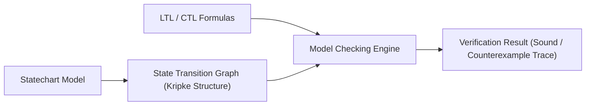
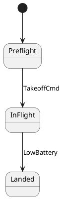
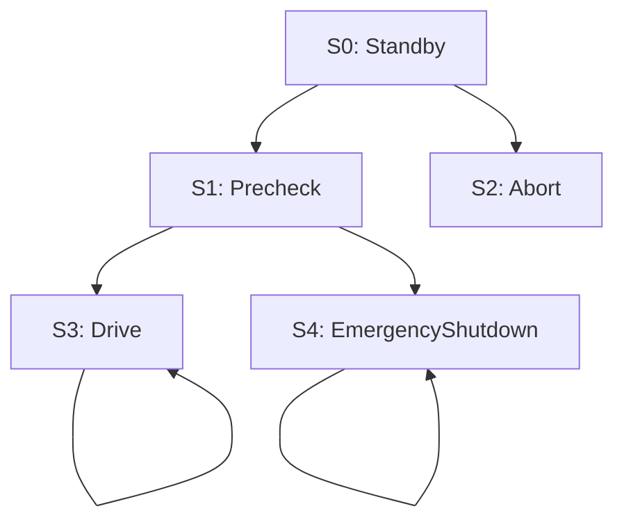

# Formal Model Checking (LTL & CTL)

`fsmc` includes a verification engine that checks statechart safety, liveness, and reachability properties against the state machine's transition graph (Kripke structure) prior to code generation.

---

## Verification Principles

Model checking systematically explores reachable state configurations and possible transition sequences to evaluate formal specifications:



- **Safety Properties**: Verify that hazardous states or invalid state combinations are never reachable.
- **Liveness Properties**: Verify that designated recovery or terminal states are guaranteed to be reached following trigger events.
- **Deadlock and Dead-State Detection**: Identifies states with no legal outgoing transitions or unreachable branches.


---

## Supported Temporal Logic Operators

The verification engine evaluates **Linear Temporal Logic (LTL)** and **Computation Tree Logic (CTL)** formulas natively over the state machine's transition graph without requiring external solvers.

### Summary Reference Table

| Logic | Operator | Formula Syntax | Semantics & Description | Example Pattern |
| :--- | :--- | :--- | :--- | :--- |
| **LTL** | **Globally (Always)** | `G (P)` | Property `P` must hold in **every** reachable state. | `G !(Armed && Charging)` |
| **LTL** | **Finally (Eventually)** | `F (P)` | Property `P` is guaranteed to become true **at least once** in future execution. | `F (SystemReady)` |
| **LTL** | **Response (Leadsto)** | `G (P -> F Q)` | Whenever stimulus `P` occurs, response `Q` is **guaranteed** to eventually follow. | `G (FaultDetected -> F SafeHold)` |
| **LTL** | **Next State** | `X (P)` | Property `P` must hold in the **immediate next** cycle step. | `G (DisarmCmd -> X Disarmed)` |
| **LTL** | **Until** | `P U Q` | Condition `P` remains true **continuously** until `Q` becomes true. | `Preheating U TargetTempReached` |
| **LTL** | **Recurrence** | `G F (P)` | Property `P` holds **infinitely often** across all cycles. | `G F (HeartbeatAck)` |
| **LTL** | **Persistence** | `F G (P)` | Eventually, property `P` holds **permanently** from some point onward. | `F G (InOrbit)` |
| **CTL** | **Exists Next** | `EX (P)` | There exists **at least one immediate successor** state satisfying `P`. | `EX (Calibrating)` |
| **CTL** | **All Next** | `AX (P)` | **All immediate successor** states satisfy `P`. | `AX (Preflight)` |
| **CTL** | **Exists Finally (Reachability)** | `EF (P)` | There exists **at least one reachable path** leading to a state satisfying `P`. | `EF (EmergencyStop)` |
| **CTL** | **All Finally (Inevitability)** | `AF (P)` | On **all possible execution paths**, `P` is inevitably reached. | `AF (Standby)` |
| **CTL** | **Exists Globally** | `EG (P)` | There exists an **infinite execution path** where `P` holds permanently. | `EG (NominalOperation)` |
| **CTL** | **All Globally (Universal Invariant)** | `AG (P)` | In **all reachable states across all paths**, `P` holds unconditionally. | `AG (!(Overheat && HighPower))` |
| **CTL** | **Exists Until** | `E[P U Q]` | There exists **at least one path** where `P` holds until `Q` is reached. | `E[Charging U Full]` |
| **CTL** | **All Until** | `A[P U Q]` | On **all possible branching paths**, `P` holds until `Q` is reached. | `A[Precheck U Drive]` |

---

## Running Verification via CLI

You can invoke the built-in formal model checker with `-V` / `--verify` (or positional `verify`):

```bash
fsmc -i examples/01_basic_patterns/network_protocol/connection.sysml --verify
```

### Options and Flags

| Option | Argument | Description | Default |
| :--- | :--- | :--- | :--- |
| `--engine` | `auto`, `internal`, `nuxmv` | Verification engine (`auto`/`internal` run the built-in graph model checker; `nuxmv` delegates to an external `nuXmv` solver if available). | `auto` |
| `--ltl` | `"<formula>"` | Injects an ad-hoc LTL formula for verification on the input model. | `""` |
| `--ctl` | `"<formula>"` | Injects an ad-hoc CTL formula for verification on the input model. | `""` |

### Passing Verification Report

```text
============================================================================
 Formal Model Verification Report: ConnectionFSM
============================================================================
 Input File:       examples/01_basic_patterns/network_protocol/connection.sysml
 States:           4
 Total Events:     8
 Transitions:      11
 Choice Nodes:     0
 Deferred Triggers:0
----------------------------------------------------------------------------
 Diagnostics:
  [INFO] (EventQueueBound): Estimated maximum event queue bound: 2 slots (max deferred: 0, max burst emits: 0).
  [INFO] (I_WCET_BOUND): Certified maximum micro-step bound per macro-step: 0 steps.
----------------------------------------------------------------------------
 Verification Status: PASSED (Model Sound & Properties Verified)
============================================================================
```

### Ad-Hoc LTL / CTL Verification from CLI

When verifying custom temporal properties via `--ltl` or `--ctl`, any violation outputs `E_MODEL_CHECK_VIOLATION` along with an execution counterexample trace:

```bash
fsmc -i examples/01_basic_patterns/network_protocol/connection.sysml --verify \
    --ltl "G (state == Disconnected -> F state == Connected)"
```

Example failure output format:
```text
error[E_MODEL_CHECK_VIOLATION]: Formal property 'cli_ltl_property' [Safety] VIOLATED: Invariant 'G (State == Closed -> F State == Established)' evaluated to false in state 'Suspended'
Counterexample execution trace:
    Step 0: State 'Disconnected' --[ConnectCmd]--> (Initial active state)
    Step 1: State 'Connecting' --[HandshakeOkEvent]--> (Normal transition execution)
    Step 2: State 'Connected' --[NetworkDegradedEvent]--> (Normal transition execution)
    Step 3: State 'Suspended' (Property violated in state 'Suspended')
```

### nuXmv / SMV Formal Logic Export

You can export the transition model into canonical SMV logic (`--export smv`) for external verification with `nuXmv`:

```bash
# Export formal SMV specification
fsmc -i flight_mission.sysml --export smv -o flight_model.smv

# Execute nuXmv externally
nuXmv flight_model.smv
```

---

## Specifying Properties in Models

### 1. In OMG SysML v2
Use either native `assert property Name : Formula;` or a `// @fsm:property` comment directive:

```sysml
package FlightControl {
    state def AircraftMission {
        entry; then Preflight;
        state Preflight;
        state InFlight;
        state Landed;

        // Formal Safety Property: Mutual exclusion between Preflight and InFlight
        // @fsm:property DisjointFlight = "G (!(Preflight && InFlight))";

        // Formal Liveness Property: Low battery always eventually leads to Landed
        // @fsm:property SafeLandingOnLowBattery = "G (LowBattery -> F Landed)";
    }
}
```

### 2. In PlantUML / Mermaid


---

## Practical Temporal Logic Recipes

#### 1. `G (P)` — Safety Invariants ("Bad things never happen")
Use `G` (Globally) when a condition must **always** remain true throughout the lifecycle of the state machine:

```sysml
// @fsm:property DisjointFlight = "G (!(Preflight && InFlight))";
// @fsm:property NoDriveWhileCharging = "G (Charging -> !MotorsEnabled)";
```

#### 2. `F (P)` — Eventual Completion ("Good things eventually happen")
Use `F` (Finally) to verify that the state machine reaches an operational target:

```sysml
// @fsm:property BootCompletes = "F (Operational)";
```

#### 3. `G (P -> F Q)` — Response / Leadsto
Proves that whenever trigger/fault `P` occurs, response state `Q` is eventually reached:

```sysml
// @fsm:property LowBatteryRecovery = "G (LowBattery -> F Landed)";
// @fsm:property ResetGuaranteed = "G (EvReset -> F Standby)";
```

#### 4. `X (P)` — Immediate Step Transition
Verifies the immediate successor state following an event:

```sysml
// @fsm:property InstantDisarm = "G (EmergencyStop -> X Disarmed)";
```

#### 5. `P U Q` — Holding Conditions (Until)
Proves `P` holds continuously along all paths until `Q` becomes true (note you can reference either `state == StateName` or bare `StateName` identifiers):

```sysml
// @fsm:property HoldUntilCalibrated = "(state == Preflight) U (state == Ready)";
```

#### 6. `G F (P)` — Recurrence ("Infinitely Often") & 7. `F G (P)` — Persistence
Evaluated via Strongly Connected Components (SCC) decomposition:

```sysml
// @fsm:property ServicedInfinitelyOften = "G F (state == ProcessTelemetry)";
// @fsm:property EventuallyStabilized = "F G (state == SteadyOrbit)";
```

### EFSM Data-Path Integration & Composite Operators
You can combine relational predicates (`temp <= 100.0`) and boolean connectives (`&&`, `||`, `!`, `->`):

```sysml
// @fsm:property CriticalFaultBrake = "G ((SensorFault && HighSpeed) -> F EmergencyBrake)";
```

| Safety Archetype | Informal Requirement | Canonical LTL Template | Concrete `fsmc` Example |
| :--- | :--- | :--- | :--- |
| **Deadlock Freedom** | No unintended trap states without outgoing paths. | `G (!Deadlock)` | Built-in structural check (`--verify`) |
| **Hazard Invariant** | Hazardous states are blocked when interlocks trip. | `G (HazardTrigger -> SafeState)` | `G (DoorOpen -> !Spin)` |
| **Fault Recovery (Response)** | Fault conditions transition to a safe degraded state. | `G (Fault -> F RecoveryState)` | `G (LowBattery -> F Landed)` |
| **Strict Ordering (Precedence)** | High-energy mode requires completed self-test. | `!ArmState U SelfTestPassed` | `!Armed U CalibrationDone` |
| **Reversibility / Home Reachability** | System can always recover back to Standby. | `G (F Standby)` | `G (F Idle)` |

---

## Diagnosing Counterexample Violations

When a property fails, the model checker emits `error[E_MODEL_CHECK_VIOLATION]` with an execution trace pinpointing the failing sequence:

#### Case A: Safety Invariant Violation (Finite Trace)

=== "Flawed Model (Triggers E_MODEL_CHECK_VIOLATION)"
    ```sysml
    package SystemSafety {
        state def PowerUnit {
            state Disconnected;
            state Charging;
            state HighLoad;

            // @fsm:property SafeOperation = "G !(Charging && HighLoad)";

            entry; then Disconnected;

            transition plug_in first Disconnected then Charging;
            transition start_load first Charging then HighLoad; // Bug: transitions into HighLoad
        }
    }
    ```

=== "Compiler Counterexample Output"
    ```text
    error[E_MODEL_CHECK_VIOLATION]: Formal property 'SafeOperation' [Safety] VIOLATED: Invariant 'G !(Charging && HighLoad)' evaluated to false in state 'HighLoad'
    Counterexample execution trace:
        Step 0: State 'Disconnected' --[plug_in]--> Charging
        Step 1: State 'Charging' --[start_load]--> HighLoad
    ```

=== "Resolved Model (Clean)"
    ```sysml
    package SystemSafety {
        state def PowerUnit {
            state Disconnected;
            state Charging;
            state HighLoad;

            // @fsm:property SafeOperation = "G !(Charging && HighLoad)";

            entry; then Disconnected;

            transition plug_in first Disconnected then Charging;
            transition stop_and_load first Charging accept EvStartLoad then Disconnected;
            transition enable_load   first Disconnected accept EvEnableLoad then HighLoad;
        }
    }
    ```

#### Case B: Liveness / Response Violation (Lasso Cycle)

=== "Flawed Model with Livelock (Triggers E_MODEL_CHECK_VIOLATION)"
    ```sysml
    package FlightSystem {
        state def MissionController {
            state InFlight;
            state HoldingPattern;
            state Landed;

            // @fsm:property SafeLanding = "G (LowBattery -> F Landed)";

            transition on_low_bat first InFlight accept LowBattery then HoldingPattern;
            transition hold_loop first HoldingPattern accept EvHoldTick then HoldingPattern;
        }
    }
    ```

=== "Compiler Counterexample Output"
    ```text
    error[E_MODEL_CHECK_VIOLATION]: Formal property 'SafeLanding' [Liveness] VIOLATED: 'Landed' is not reachable from cyclic state 'HoldingPattern'
    Counterexample Lasso Execution Trace:
      Prefix:
        Step 0: InFlight --[LowBattery]--> HoldingPattern
      Cycle:
        Step 1: HoldingPattern --[EvHoldTick]--> HoldingPattern
    ```

=== "Resolved Model (Clean)"
    ```sysml
    package FlightSystem {
        state def MissionController {
            state InFlight;
            state HoldingPattern;
            state Landed;

            // @fsm:property SafeLanding = "G (LowBattery -> F Landed)";

            transition on_low_bat first InFlight accept LowBattery then HoldingPattern;
            transition hold_loop first HoldingPattern accept EvHoldTick if in.holding_time < 5.0 then HoldingPattern;
            transition descend   first HoldingPattern if in.holding_time >= 5.0 then Landed;
        }
    }
    ```

---

## CTL Branching Semantics & Fixed-Point Engine Internals

While LTL reasons over linear execution traces, Computation Tree Logic (CTL) quantifies over branching execution paths (`E` existential, `A` universal):



- **`E` (Existential Path Quantifier)**: e.g. `EF (Standby)` checks whether at least one path can return to `Standby`.
- **`A` (Universal Path Quantifier)**: e.g. `AG (Fault -> AF Recovery)` checks whether recovery holds across all branches.

`fsmc` computes CTL satisfaction sets $Sat(\Phi) \subseteq S$ via fixed-point iteration on the explicit Kripke structure:

$$\begin{aligned}
Sat(EX(\Phi)) &= \{ s \in S \mid \exists s' \in Succ(s) : s' \in Sat(\Phi) \} \\
Sat(AX(\Phi)) &= \{ s \in S \mid \forall s' \in Succ(s) : s' \in Sat(\Phi) \} \\
Sat(EF(\Phi)) &= \mu Z . (Sat(\Phi) \cup Sat(EX(Z))) \quad \text{(Backward BFS Least Fixed-Point)} \\
Sat(AF(\Phi)) &= \mu Z . (Sat(\Phi) \cup Sat(AX(Z))) \quad \text{(All-Path Inevitability)} \\
Sat(EG(\Phi)) &= \nu Z . (Sat(\Phi) \cap Sat(EX(Z))) \quad \text{(Greatest Fixed-Point via Tarjan SCCs)} \\
Sat(AG(\Phi)) &= \nu Z . (Sat(\Phi) \cap Sat(AX(Z))) \quad \text{(Universal Safety)} \\
Sat(E[\Phi_1 \mathbin{U} \Phi_2]) &= \mu Z . (Sat(\Phi_2) \cup (Sat(\Phi_1) \cap Sat(EX(Z)))) \\
Sat(A[\Phi_1 \mathbin{U} \Phi_2]) &= \mu Z . (Sat(\Phi_2) \cup (Sat(\Phi_1) \cap Sat(AX(Z))))
\end{aligned}$$

Because the finite Kripke graph is bounded by $|S|$ states, fixed-point evaluation terminates in $O(|S| + |T|)$ steps without requiring external solver binaries.

!!! note "Sound Interval Evaluation & Formula Negation"
    In EFSM models with numeric datapath variables, atomic relational predicates under negation (such as `!(x == 5)` or `!(altitude < 1000)`) are evaluated via relational operator inversion ($x \neq 5$ and $\text{altitude} \ge 1000$) rather than boolean complement, preserving sound three-valued evaluation over interval lattices.
